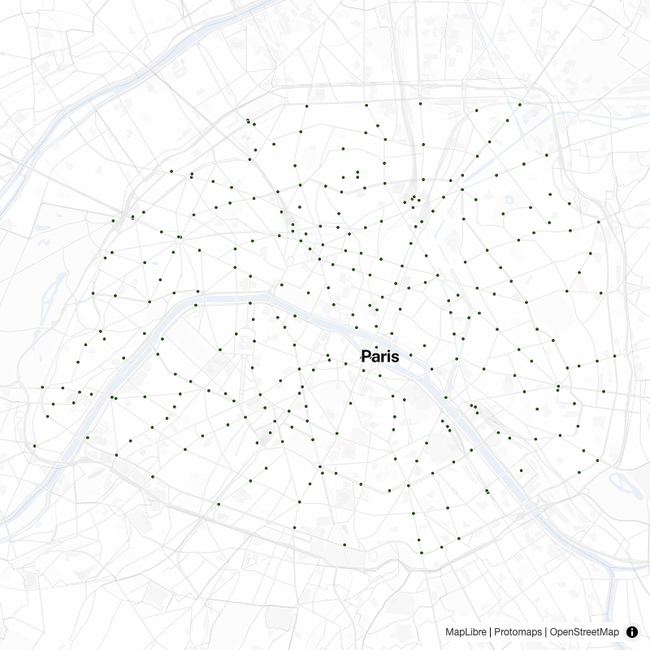

# www

Website for [BikeNetKit](https://bikenetkit.org), a showroom for the BikeNetKit family of
bicycle-network tools, with interactive maps for five of them. See [../README.md](../README.md) for
what the project is.



## Stack

- [SvelteKit 2](https://svelte.dev/docs/kit) + [Svelte 5](https://svelte.dev/) (runes)
- [Tailwind CSS v4](https://tailwindcss.com/)
- [MapLibre GL](https://maplibre.org/) via [svelte-maplibre-gl](https://github.com/MIERUNE/svelte-maplibre-gl)
- [`@sveltejs/adapter-static`](https://svelte.dev/docs/kit/adapter-static) (fully static build, deploys without a Node runtime)
- [pnpm](https://pnpm.io/)

## Getting started

```sh
cp .env.example .env     # required: PUBLIC_* vars are statically imported
pnpm install             # also installs the Chromium that Playwright uses
# add the display font now; see § Fonts below
pnpm dev
```

Without `.env`, `pnpm build` fails with `"PUBLIC_BASEMAP_URL" is not exported by
"$env/static/public"`. The example values are enough to build and browse; none of them is secret.
A clean clone with them copied builds the full site, needing no data on disk and no reachable data
host. To see the bicycle networks on the maps, set `PUBLIC_DATA_URL=https://data.bikenetkit.org`.

## Fonts

All of the type ships in the repo **except Bespoke Sans, the display face**. Its licence
([ITF FFL](https://www.fontshare.com/licenses/itf-ffl)) permits self-hosting it for this site but
not putting it on a publicly accessible repository, so you need your own copy: download
`BespokeSans_Complete.zip` from <https://www.fontshare.com/fonts/bespoke-sans> and unzip into
`static/fonts/`, where `.gitignore` keeps it out of commits. The zip's folder names already match
the `@font-face` rules in [src/routes/layout.css](src/routes/layout.css), and you only need the two
`.woff2` variables, `BespokeSans-BoldItalic.woff`, and `License/FFL.txt`. **Do not subset or
convert them**, since § 02 of the licence forbids both. `pnpm fonts:check` runs on `dev`, `build`
and `lint` and tells you exactly this when a file is missing. Without the font the site still
builds, but headings fall back to a generic sans, and the deploy scripts refuse to upload such a
build.

The other families are all [SIL OFL](https://openfontlicense.org/) and are committed: Public Sans,
IBM Plex Mono, and the Noto Sans sources under [scripts/glyph-src/](scripts/glyph-src/) that
`pnpm build:glyphs` merges into the MapLibre glyph stacks.

## Scripts

The everyday ones, all run from `www/`:

| Script         | Description                                        |
| -------------- | -------------------------------------------------- |
| `pnpm dev`     | Start the Vite dev server                          |
| `pnpm build`   | Build the static site to `build/` (slow)           |
| `pnpm preview` | Serve the production build                         |
| `pnpm lint`    | Prettier check and ESLint                          |
| `pnpm check`   | `svelte-check`, including type checks of `.svelte` |
| `pnpm test`    | The Playwright smoke suite                         |

The full list, split into what anyone can run and what needs SSH to the server, is in
[AGENTS.md § Common commands](../AGENTS.md#common-commands-run-from-www). How to run the smoke
suite is in [CONTRIBUTING.md § Testing](../CONTRIBUTING.md#testing).

## No external runtime dependencies

The site should keep working for a long time without maintenance, so **nothing may load from a
third-party origin at runtime**: no CDN scripts, fonts, tiles, or iframes. The basemap is
self-hosted ([DEPLOY_TILES.md](DEPLOY_TILES.md)); fonts and glyphs are served from `static/`.

Treat this as a standing invariant. It is checked by a command rather than by eye:

```sh
pnpm build
pnpm check:build-output
```

`scripts/check-build-output.mjs` reads the built HTML and bundles by context, because a link and a
dependency are the same string. A host in a **fetch context** (`src`, `srcset`, `<link href>`,
CSS `url()` and the like) must be one of ours. A **link** (`<a href>`) may name any host, since a
reader clicking away cannot break the site, so links are not listed anywhere. A URL **string in
JavaScript** passes only if its host is ours, linked from some page, or in the script's short,
commented `NEVER_FETCHED` list. Adding to that list is a deliberate act; do it in a commit that
says why. The same run also checks that prerendered pages carry real text, not an empty shell.

What the browser actually requests is checked too, by `tests/privacy.e2e.ts` in `pnpm test`: it
loads one page of each family, including a live map and `/design`, and fails on any request to a
host other than the site, `tiles.bikenetkit.org` and `data.bikenetkit.org`. That covers the one
case the build scan cannot see, a host the site links to and also fetches from a script.

`unpkg.com` is the entry in `NEVER_FETCHED` worth knowing about: `svelte-maplibre-gl` injects a
`<link>` to MapLibre's CSS from unpkg unless told not to. Every `<MapLibre>` in this repo passes
`autoloadGlobalCss={false}`, and the CSS is imported in [src/routes/layout.css](src/routes/layout.css)
instead. The string survives in the bundle as dead code. **Any new `<MapLibre>` must pass that
prop.**

## Structure

```text
src/
  app.html
  hooks.server.ts             # build preflight against the committed data manifest
  routes/
    layout.css                # design tokens and every global style
    +page.svelte              # landing page
    (app)/                    # everything with the sidebar layout
      (map)/<tool>/           # interactive maps, /<tool>/<city>/…
      (tools)/(interactive)/  # one page per interactive tool
      cities/                 # city index, per-city pages, coverage table
      more-tools/             # the static tools, one page with anchored sections
    animation/                # chrome-free build-up for the GIF and video exports
    design/                   # design-system reference, the live companion to DESIGN.md
    embed/                    # embeddable map per tool and city
    legal/                    # publisher, privacy, accessibility, credits
    og/                       # Open Graph card capture routes (per tool, per city)
    screenshot/               # capture route for the screenshot generator
    llms-full.txt/, sitemap.xml/
  lib/
    components/               # shared UI: ui/ primitives, map/, map-shell/, landing/, tool/, …
    data/                     # tool catalogue (tools.json), committed manifests, loaders
    map-style/                # MapLibre style, layers and paint
    state/                    # shared reactive state
    design/                   # helpers behind the /design page
    export/                   # props for the map's SVG download
    utils/                    # formatting, geometry and URL helpers
    assets/                   # brand images and media
    colors.js                 # raw hex for MapLibre paint
scripts/                      # data import, checks, capture and deploy tooling
static/                       # served as-is: fonts, OG cards, media
tests/                        # Playwright smoke, accessibility and capture specs
```

## Animated exports

`/animation/[tool]/[city]` renders an ordered build-up with no legend, HUD, playback bar or
navigation control. Two Playwright drivers step it frame by frame, wait for MapLibre's `idle` event
on each frame, and hand the frames to ffmpeg; their shared code is in
[scripts/capture-common.mjs](scripts/capture-common.mjs).

The route reads its options from the query string: `size` (or `width` and `height`, in CSS px,
default 800), `padding` (CSS px, default 40), `weight` (a line-width multiplier, default 1),
`labels=0`, `attribution=0` and `seeds=0` to hide those, and `metric` / `type` / `variant` to pick
the dataset (default: the tool's).

`pnpm generate:gif` writes an 800×800 GIF to `static/media/`; it defaults to GrowBikeNet in
`paris_fr`, `betweenness` / `rail` / `from_scratch`, with labels. `pnpm generate:video` writes
3840×2160 H.264 to the gitignored `exports/`; it defaults to GrowBikeNet in `copenhagen_dk`,
`betweenness` / `grid` / `from_bikenw`, with labels and attribution off. `pnpm generate:videos`
renders both target cities, Copenhagen and Podgorica. The `FLAGS` and `opts` objects at the top
of [scripts/generate-video.mjs](scripts/generate-video.mjs) and
[scripts/generate-gif.mjs](scripts/generate-gif.mjs) list every option and its default.

A video lasts `--duration` × `--fps` frames by default, so long build-ups are subsampled and short
ones hold each step for several frames. `--per-step` renders exactly one frame per step instead.

Three things to know before changing it:

- **Resolution comes from `--scale`, not from a bigger viewport.** MapLibre sizes line widths in
  CSS pixels, so a 3840-wide viewport would render the network as hairlines. 1920×1080 at
  `deviceScaleFactor: 2` gives a true 3840×2160 at the designed weights. The script refuses
  anything above MapLibre's 4096² `maxCanvasSize` rather than let it be silently downscaled.
- **Attribution off is a licensing obligation, not a free choice.** The basemap is OSM/ODbL via
  Protomaps, so wherever a video is published the credit has to appear: in the edit, on an end
  card or in the description. `--attribution` puts it back in-frame.
- **Don't edit files under `www/` during a run.** Both drivers reuse a running `vite dev` server,
  and an HMR reload breaks the capture mid-render. `generate-video.mjs` detects this and fails;
  `--base-url` against a `pnpm preview` build avoids it.

### Hero clips

`pnpm generate:hero-clips` renders the per-city clips listed in `scripts/hero-clips.json`, for
social media and talks. Each clip shows one city and one tool. It has the landing hero's look
(the label-free white basemap, the existing network, the tool's layer and the pitched orbit), but
no logo, headline, HUD or credit. Every clip runs the same 14 s at 60 fps: a 1 s fade in from
white, a 5 s build-up, 4 s of orbit around the finished network, a 3 s tear-down in reverse, and
a 1 s fade out to white. So the clips line up in the edit.

```
pnpm generate:hero-clips -- --base-url http://localhost:5187        # all 20 -> exports/hero-clips
pnpm generate:hero-clips -- --only "berlin|paris"                   # regex on <tool>/<city>
pnpm generate:hero-clips -- --fps 10 --codecs h264                  # fast framing pass
pnpm generate:hero-clips -- --orbit-speed 6 --hold 6 --scale 2      # variations
pnpm generate:hero-clips -- --transparent                           # no basemap, + alpha master
pnpm generate:hero-clips -- --tight                                 # closer framing for social
pnpm generate:hero-clips -- --tight --width 1080 --height 1920      # 9:16 portrait, -1080x1920 in the name
pnpm generate:hero-clips -- --out-dir /Volumes/Work/hero-clips      # ~15 GB of ProRes
```

Each clip writes these files to `exports/hero-clips/`, named `NN-<tool>-<city>-<combo>`:

- a ProRes 422 HQ master (`.mov`) and an H.264 MP4, both BT.709-tagged;
- under `--transparent`, also a ProRes 4444 with alpha (`-alpha.mov`);
- a sidecar `.json` with the city, tool and metric labels, the step count and the phase times,
  for titles in post;
- a `-sheet.png` contact sheet for checking the framing.

`--tight` frames the network's dense core instead of the whole city: 1.2 zoom stops past the
fit (1.7 for a portrait frame, whose fit is limited by its width), centered on the median vertex of the revealed layer, with the outskirts running off the
edges. Its clips carry a `-tight` suffix, so they sit next to the full-city set. `--zoom <stops>`
and `--focus data|lon,lat` tune it directly, and a manifest entry's own `zoom` and `focus` apply
under `--tight`.

Finished clips are skipped, so an interrupted run resumes; `--force` redoes them. A clip counts as
finished only once its sidecar `.json` exists, because the sidecar is written after ffmpeg has
closed the files. Each manifest entry can set its own `bearing`, `padding`, `weight` (a line-width
multiplier for the tool layer only) and phase durations.

Filenames start with the entry's position in the manifest. So add new clips at the end, because
inserting one renames every clip after it. `--scale` means **supersampling** here: the output
stays at `--width` × `--height`. In `generate:video`, the same flag scales the output resolution.

- The basemap credit is not in the frame. Wherever a clip is published, "© OpenStreetMap
  contributors" has to appear in the edit, on an end card or in the caption.
- The script renders on the GPU (Chromium's Metal ANGLE backend), at about 0.3 s per frame, so
  about 4.5 min per clip. `--no-gpu` falls back to SwiftShader at about 2 s per frame.
- The page and the script talk through `window.__clip` (`frames`, `meta`, `seek`) and the
  `data-clip-ready` / `data-clip-error` flags on `<body>`. Both import that contract from
  `src/lib/hero-clip/bridge.js`, so change it there.
- Pass `--base-url` explicitly. The script otherwise probes `:5173` first, which may be another
  project's dev server. The same rule as above applies: don't edit `www/` during a run.

## Licence

The BikeNetKit code is licensed under the **GNU Affero General Public License v3.0 or later**,
© 2026 Moritz Stefaner ([../LICENSE](../LICENSE)). Public Sans, IBM Plex Mono and Noto Sans are
**SIL OFL** and committed with their licence notices (Noto Sans's is in
[scripts/glyph-src/README.md](scripts/glyph-src/README.md)), and `/legal` credits the two served
faces. Bespoke Sans is **ITF FFL**, self-hosted and not committed ([§ Fonts](#fonts)). Map data is © OpenStreetMap contributors
(ODbL) with Protomaps basemap tiles, credited in the map and in [DEPLOY_TILES.md](DEPLOY_TILES.md). The basemap
style code in `src/lib/map-style/` (`layers.js`, `text-field.js`) is derived from Protomaps'
[`@protomaps/basemaps`](https://github.com/protomaps/basemaps), which is **BSD-3-Clause**; its
notice is in [src/lib/map-style/LICENSE-protomaps.md](src/lib/map-style/LICENSE-protomaps.md).

## Related docs

| Document                                           | Covers                                       |
| -------------------------------------------------- | -------------------------------------------- |
| [DESIGN.md](DESIGN.md)                             | Visual spec and design tokens                |
| [DATA_CONTRACT.md](DATA_CONTRACT.md)               | What the importer expects from a tool export |
| [DOCS_MAP_INTEGRATION.md](DOCS_MAP_INTEGRATION.md) | Using the site's basemap in the docs site    |
| [DEPLOY_NGINX.md](DEPLOY_NGINX.md)                 | Serving the site                             |
| [DEPLOY_TILES.md](DEPLOY_TILES.md)                 | Building and serving the self-hosted basemap |
| [DEPLOY_DATA.md](DEPLOY_DATA.md)                   | The off-repo GeoJSON host                    |
| [DEPLOY_STATS.md](DEPLOY_STATS.md)                 | Cookieless visitor stats                     |
| [../OPERATIONS.md](../OPERATIONS.md)               | Server layout, deploys, TLS, triage          |
| [../CONTRIBUTING.md](../CONTRIBUTING.md)           | Setup, checks, tests and conventions         |
| [../EDIT_CONTENT.md](../EDIT_CONTENT.md)           | Changing the text, without touching the data |
| [../ADD_A_CITY.md](../ADD_A_CITY.md)               | Adding a city to the catalogue               |
| [../ADD_A_TOOL.md](../ADD_A_TOOL.md)               | Adding a tool                                |
